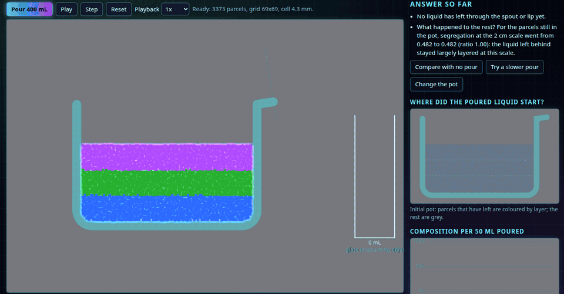
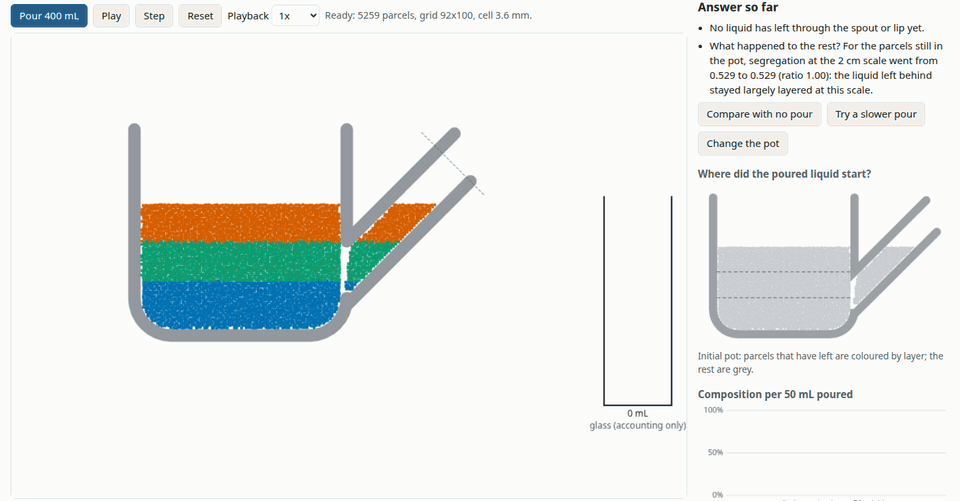
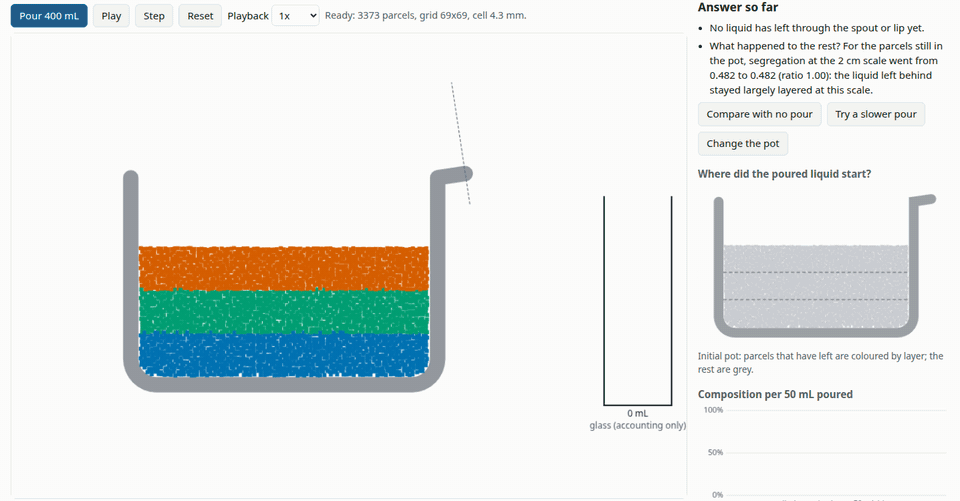
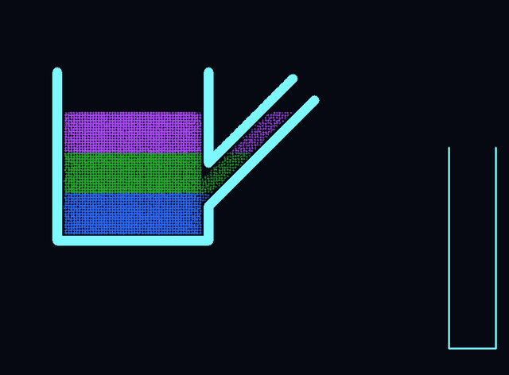

# PourLab — where does poured tea come from?

[](https://github.com/marcelpetrick/teapotFluidSimulation/actions/workflows/pipeline.yml)
[](https://marcelpetrick.github.io/teapotFluidSimulation/)
[](https://github.com/marcelpetrick/teapotFluidSimulation/releases/latest)
[](LICENSE)
[](https://www.typescriptlang.org/)
[](vite.config.ts)
[](e2e/app.spec.ts)

**Pour 400 mL from a 1.5 L teapot: which water ends up in your cup, and does pouring stir the rest?**
PourLab answers that with a real 2D fluid simulation in your browser — every parcel of tea keeps the
colour of the layer it started in.

**▶ Try it: <https://marcelpetrick.github.io/teapotFluidSimulation/>** — no install, no account.



| Teapot with a low spout                                                                                      | German glass teapot (lip at the top)                                       |
| ------------------------------------------------------------------------------------------------------------ | -------------------------------------------------------------------------- |
|                                                |       |
| Liquid leaves through a low inlet: **25 % bottom, 52 % middle, 23 % top** layer, plus what sat in the spout. | Liquid can only leave over the rim: **0 % bottom, 39 % middle, 61 % top**. |

## Does it hold in 3D?



An offline 3D reference (cylindrical 1.5 L teapot, real round 2 cm spout) gives **29 % bottom, 51 %
middle, 20 % top** for the same pour — within about 3 points of the 2D model. The thermal mode is checked
against the standard heated-cavity benchmark. Details: [`docs/validation.md`](docs/validation.md).

**The 3D view has two modes.** **Open 3D recording** plays back the offline CPU solver's output. **Run 3D
live on your GPU** computes the same pour while you watch, with a WebGPU port of that solver. You can
rotate, zoom and pan in both. Live mode also lets you restart the pour, switch to finer 4 mm cells, or tilt
the pot yourself. Without WebGPU, the live button is disabled and the recording remains.

| Run                                     | Simulated pour | Compute time           | Compared with real time |
| --------------------------------------- | -------------- | ---------------------- | ----------------------- |
| 3D CPU, 5 mm cells, 45 k parcels (half) | 11.5 s         | 684 s (one CPU core)   | ~60× slower             |
| 3D CPU, 4 mm cells, 89 k parcels (half) | 11.5 s         | 1 636 s (one CPU core) | ~140× slower            |
| 3D GPU, 5 mm cells (RTX A2000 laptop)   | 11.5 s         | 6.4 s                  | 1.8× faster             |
| 3D GPU, 4 mm cells (RTX A2000 laptop)   | 11.5 s         | 13.3 s                 | 0.87× (slower)          |
| 2D default (live in the browser)        | —              | —                      | 1.2× faster             |

The GPU solver reproduces the CPU result: the same poured volume within 0.3 % and the same layer shares
within 1.3 points (`scripts/verify-gpu.ts`, [`benchmarks/gpu3d.json`](benchmarks/gpu3d.json)). You can run
the same comparison on your own GPU on the
[GPU check page](https://marcelpetrick.github.io/teapotFluidSimulation/verify-gpu.html). Most of the GPU
time goes into the two pressure solves per substep.

## What you can do

- **Pour** to a 400 mL target automatically, or **tilt by hand** with a slider.
- Pick a **pot model** — spout teapot, German glass teapot, pitcher — or **draw your own pot**.
- Tune **fill, tilt timing, resolution (up to 128 cells), particles per cell (up to 16)**, transfer
  scheme and **thermal effects** (warm-over-cool layering, cooling convection).
- Read the answer: composition of the poured tea, over-representation per layer, a map of where the
  poured tea started, mixing scores, and how the rest was rearranged.
- Switch the **look** between a clean lab view and **cyber neon** (glass panels, glowing liquid).
- Turn on **sound**: a generated space ambience plus a pouring sound that follows the flow.
- **Share** initial settings through a link; export **JSON**, **CSV** and **PNG**.
- See the pour in **3D**: play the recorded reference, or **run it live on your GPU** (WebGPU) and tilt
  the pot yourself. The [GPU check page](https://marcelpetrick.github.io/teapotFluidSimulation/verify-gpu.html)
  compares the GPU solver with the CPU reference on your machine.

Every control has a tooltip that explains what it does. Model limits are always shown next to the
results: this is a qualitative 2D model, not a calibrated digital twin of your teapot.

## Performance and evidence

The review measured render-call cost at the maximum 180,035 parcels: **147 ms → 11 ms** on the reference laptop.
This measures submission work, not real-time simulation at maximum resolution.
A [follow-up paced test](docs/performance.md) exposed about 10.9 redraw opportunities/s at maximum count.
The new dense pixel renderer raised that sample to about 60, while retaining all simulated parcels.
The CPU-throttled phone layout also improved; real-phone performance remains unmeasured.
See [performance evidence](docs/performance.md) for the method and raw data.

The represented-volume drift gate remains unmet. Results are exploratory, with no measured real-pot validation.
The [151-row requirements matrix](docs/requirements.md) records completed work and the remaining gaps.

## Run locally

```bash
npm ci
npm run dev          # http://localhost:5173
```

Requires Node.js ≥ 22. `npm run build` produces a static `dist/` that works on any sub-path.

## Quality

|                      |                                                                                                                                                                     |
| -------------------- | ------------------------------------------------------------------------------------------------------------------------------------------------------------------- |
| `./localPipeline.sh` | format → lint → typecheck → unit and integration tests with **≥ 95 % coverage** → build → **e2e in Chromium and Firefox**                                           |
| CI                   | [GitHub Actions](.github/workflows/pipeline.yml) runs the same script and deploys to GitHub Pages                                                                   |
| Physics checks       | hydrostatic rest, projection convergence, moving-wall tunnelling, outflow counted once, ledger closure, determinism, analytic diffusion, buoyancy, refinement study |

## Documentation

- [Adversarial self-review](docs/red-team.md) — missed defects, corrective actions and remaining questions

- [User guide](docs/guide.md) — short procedures, controls, results and limitations
- [Review findings](docs/review.md) — confirmed defects, corrections and review limits
- [Performance evidence](docs/performance.md) — measurements and reference-state checks

- [Requirements matrix](docs/requirements.md) — 151 vision requirements, evidence, and remaining gaps
- [Owner questions](questions.md) — measurements and preferences that can be answered later

- [`docs/physics.md`](docs/physics.md) — equations, discretisation, controller, metrics and their limits
- [`docs/validation.md`](docs/validation.md) — measured verification, refinement, sensitivity, performance, 3D CPU and GPU results
- [`docs/architecture.md`](docs/architecture.md) — C4 diagrams and runtime flowcharts
- [`docs/sources.md`](docs/sources.md) — literature used
- [`scripts/README.md`](scripts/README.md) — helper scripts (verified commits, GIF rendering, calibration, …)
- [`docs/vision.md`](docs/vision.md) · [`docs/plan.md`](docs/plan.md) · [`AGENTS.md`](AGENTS.md) — specification, plan, contributor rules

## How it was built

| Area               | Implementation                                                                                       |
| ------------------ | ---------------------------------------------------------------------------------------------------- |
| Physics            | PIC/FLIP or MAC-APIC, a MAC grid, MIC(0)-PCG pressure, moving-wall fluxes and exact wall collisions. |
| Thermal model      | Temperature transport, diffusion and optional Boussinesq buoyancy.                                   |
| Browser            | TypeScript, plain DOM, Canvas 2D and a dedicated simulation worker.                                  |
| 3D                 | An offline CPU reference and an optional live WebGPU solver. Three.js renders both modes with WebGL. |
| Sound              | Generated Web Audio, off until enabled.                                                              |
| Delivery           | Vite, GitHub Actions and GitHub Pages.                                                               |
| Verification       | Vitest, coverage checks, Playwright in Chromium and Firefox, lint and type checks.                   |
| Runtime dependency | Three.js. Its MIT licence ships with the site.                                                       |

The original implementation was built with Claude Code from the written vision.
This review adds correctness fixes, interface improvements, profiling and requirements traceability.

## License

Copyright (C) 2026 Marcel Petrick &lt;mail@marcelpetrick.it&gt;. Free software under the
[GNU GPL v3 or later](LICENSE). Generated with AI from the specification in [`docs/vision.md`](docs/vision.md).
