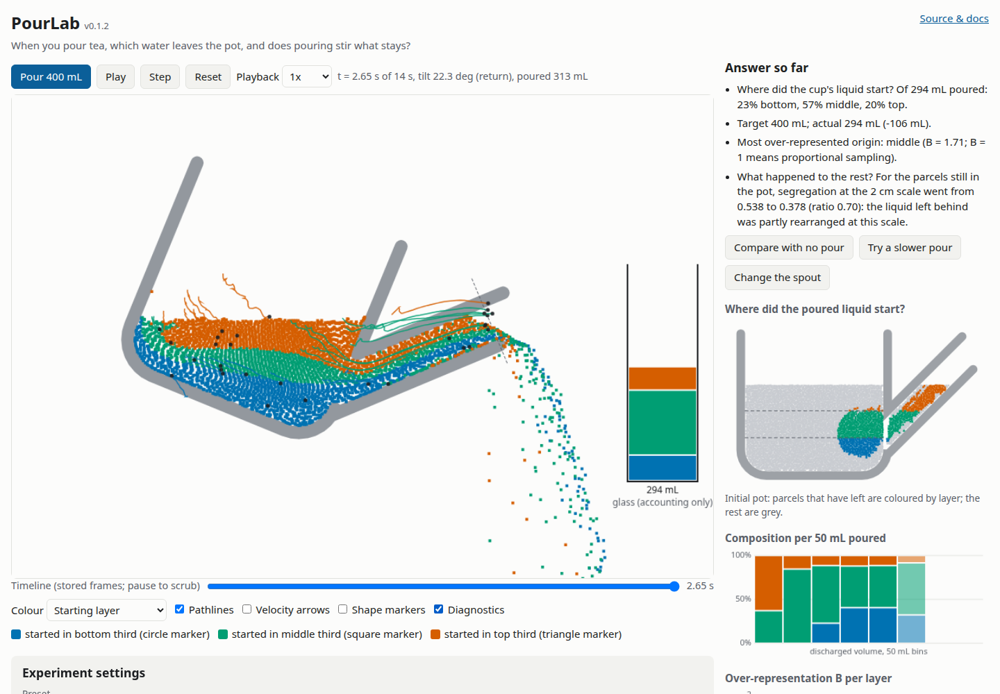

# PourLab — where does poured tea come from?

[](https://github.com/marcelpetrick/teapotFluidSimulation/actions/workflows/pipeline.yml)
[](https://marcelpetrick.github.io/teapotFluidSimulation/)
[](package.json)
[](LICENSE)
[](https://www.typescriptlang.org/)
[](https://vite.dev/)
[](vite.config.ts)
[](e2e/app.spec.ts)

**PourLab** is an interactive browser experiment that answers an everyday question:
**when you pour tea, which parts of the liquid leave the pot, which parts replace them, and how much
does pouring mix what remains?**

**▶ Run it: <https://marcelpetrick.github.io/teapotFluidSimulation/>** — no install, no account, no server
(Firefox and Chrome; WebGPU not required).

**Author: Marcel Petrick <mail@marcelpetrick.it>** · **License: GPLv3 or later, see [`LICENSE`](LICENSE).**
**Note: this project is generated with AI**, following the specification in [`vision.md`](vision.md).



## What it does

- Simulates a **2D cross-section of a 1.5 L teapot** with an incompressible free-surface liquid
  (hybrid PIC/FLIP particle-grid method, optional APIC) under gravity and a **prescribed tilt**.
- Every parcel carries a **permanent origin label** (bottom / middle / top third of the initial fill),
  so you can see where the poured liquid came from.
- The pot really tilts through a fixed world grid; liquid leaves through a **genuine spout passage**
  and is counted when it crosses the lip. Nothing is deleted to reach 400 mL: a controller decides when
  to return upright, and the actual discharge and overshoot are reported.
- Answers both questions with measured numbers:
  - _Where did the cup's liquid start?_ — composition of the discharge (cumulative and per 50 mL),
    over-representation ratio **B**, and a map of the **initial positions** of the poured parcels.
  - _What happened to the liquid left behind?_ — origin-to-region matrix, multi-scale segregation
    **S**, and a **survivor-cohort** analysis that separates selective removal from real mixing.
- Presets: gentle / faster / slower pour, still control, tilt without spilling, rim-pouring pitcher,
  repeated pours, warm-over-cool stratification and cooling-driven convection (thermal Version 2).
- Every run exports a reproducible **JSON record**, **CSV metrics** and a **PNG** view.

The model limits are always shown beside the results: it is a qualitative 2D instrument, not a
calibrated digital twin of a particular teapot. Physics and validation: [`docs/physics.md`](docs/physics.md),
[`docs/validation.md`](docs/validation.md).

## Usage

1. Open the [live page](https://marcelpetrick.github.io/teapotFluidSimulation/) (or run it locally).
2. Look at the initial layers, then press **Pour 400 mL**. Use **Play/Pause**, **Step**, playback speed,
   and the **timeline** (pause, then scrub stored frames).
3. Read **Answer so far**, the charts and the data tables. Try **Compare with no pour**,
   **Try a slower pour** and **Change the spout**; finished runs collect in **Run comparison**.
4. Change **Experiment settings** (fill, target, tilt timing, hold angle, vessel, resolution, transfer
   scheme, FLIP fraction, seed, thermal mode and temperatures) and press **Apply & reset**. Settings
   live in the URL, so **Copy share link** reproduces an experiment for anyone.
5. Open **Diagnostics** for the volume ledger, pressure residual, divergence, density drift,
   stabiliser activity and performance. Press **Space** to play or pause.

## Setup

Requirements: Node.js ≥ 22 (CI uses 24) and npm.

```bash
npm ci            # install exact, locked dependencies
npm run dev       # development server at http://localhost:5173
npm run build     # production build into dist/ (relative paths; works on any sub-path)
npm run preview   # serve the production build
```

## Testing

| Command                                                       | What it runs                                                                                                                  |
| ------------------------------------------------------------- | ----------------------------------------------------------------------------------------------------------------------------- |
| `npm test`                                                    | Vitest unit and integration tests (solver verification, metrics, config, worker host, renderer, app with happy-dom)           |
| `npm run coverage`                                            | Same with V8 coverage; fails below 95 % lines/statements/functions or 90 % branches                                           |
| `npm run e2e`                                                 | Playwright end-to-end tests in Chromium and Firefox against `dist/` served under `/teapotFluidSimulation/`, like GitHub Pages |
| `npm run lint` / `npm run typecheck` / `npm run format:check` | ESLint, `tsc --noEmit`, Prettier                                                                                              |
| `npm run bench`                                               | Headless benchmark: resolution ladder and PIC/FLIP vs APIC (writes `benchmarks/results.json`)                                 |

The verification tests cover hydrostatic rest, projection convergence, uniform advection, moving-wall
tunnelling, outflow counted once, ledger closure, determinism, origin-label immutability, controller
phases, thermal diffusion, buoyancy direction and cooling budgets.

## Pipeline

`./localPipeline.sh` is the single source of truth: install → format check → lint → typecheck →
tests with coverage → build → e2e (Chromium + Firefox). Options: `--no-e2e`, `--no-install`.
[`.github/workflows/pipeline.yml`](.github/workflows/pipeline.yml) runs the same script on every push
and pull request and, on `main`, deploys `dist/` to GitHub Pages.

Helper scripts are documented in [`scripts/README.md`](scripts/README.md): staged-commit verification,
version bumping, controller calibration, the sub-path static server and screenshot capture.

## Project layout

```text
src/sim/        solver (MAC grid, PCG pressure, PIC/FLIP + APIC), vessel geometry, motion controller,
                metrics, presets/settings, experiment records — no browser APIs, runs headless
src/worker/     worker host (testable) and Web Worker entry
src/render/     Canvas 2D scene and charts
src/ui/app.ts   main-thread application
tests/  e2e/  benchmarks/  scripts/  docs/
vision.md       product specification · plan.md implementation plan · AGENTS.md contributor rules
```

## Contributing

Work on `main` with atomic [Conventional Commits](https://www.conventionalcommits.org/); every commit bumps
the patch version (`scripts/bump-version.sh`), major features bump the minor version, and every commit
passes `scripts/verify-staged.sh` (the pipeline on exactly the staged tree). See [`AGENTS.md`](AGENTS.md).

## License

Copyright (C) 2026 Marcel Petrick. PourLab is free software: you can redistribute it and/or modify it
under the terms of the GNU General Public License as published by the Free Software Foundation, either
version 3 of the License, or (at your option) any later version. See [`LICENSE`](LICENSE) and
[`THIRD_PARTY_NOTICES.md`](THIRD_PARTY_NOTICES.md).
