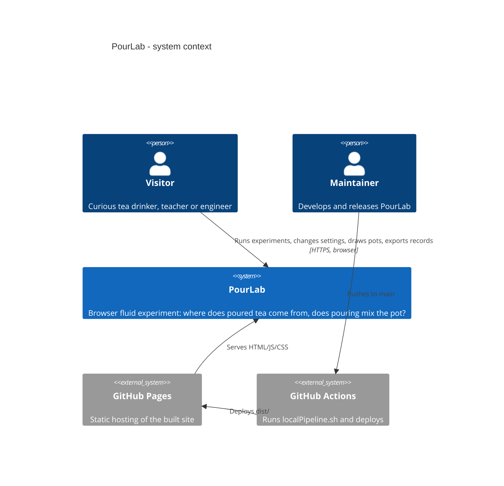
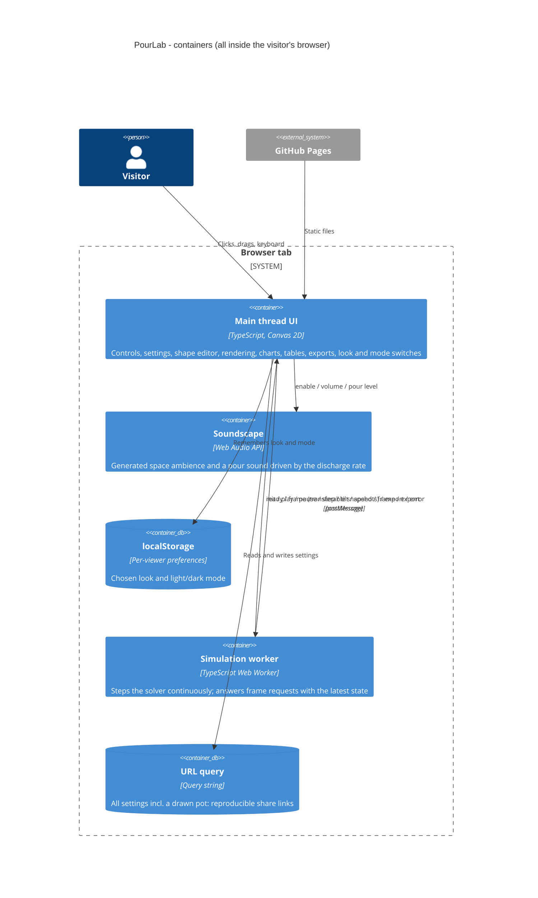
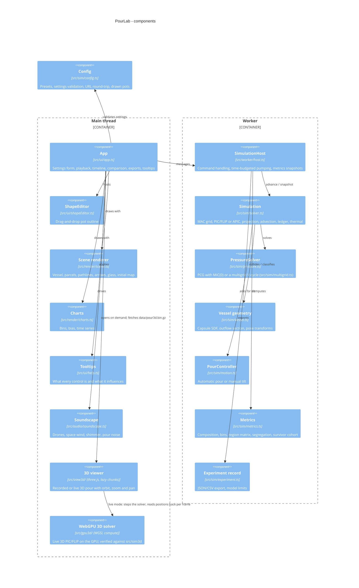
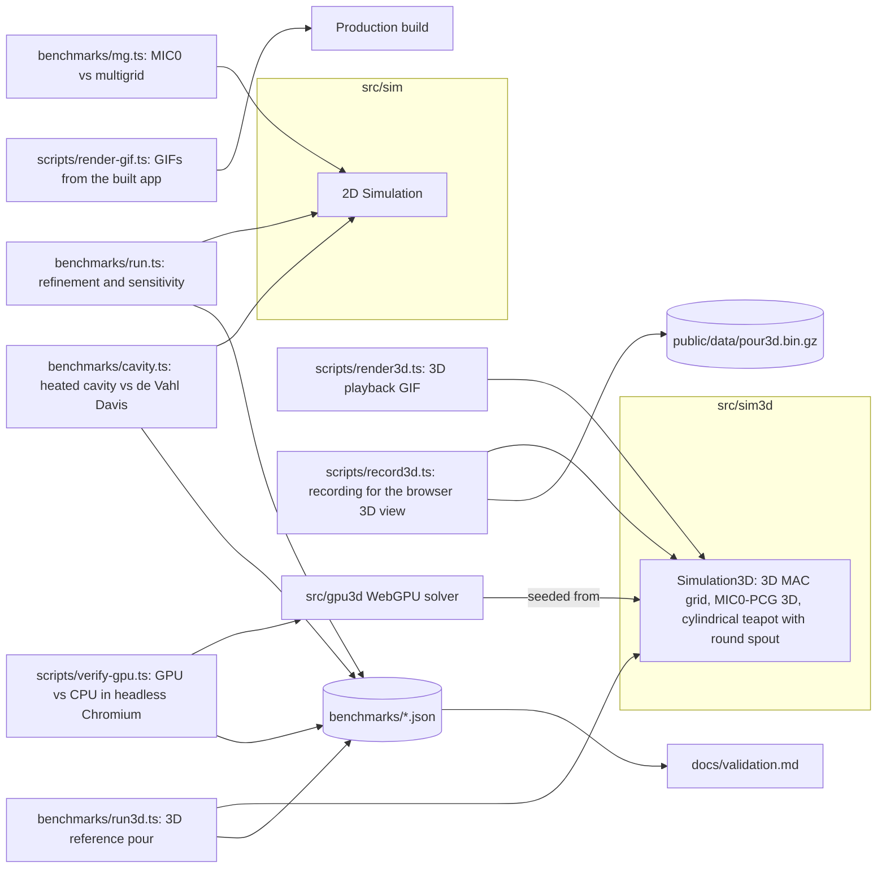
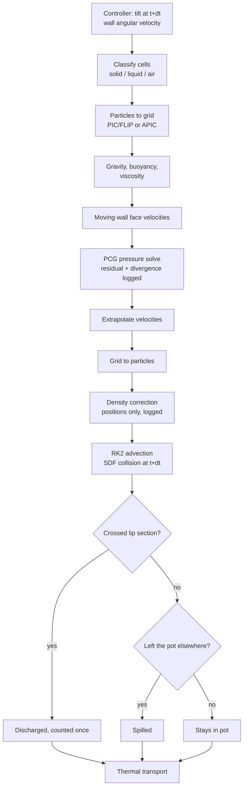
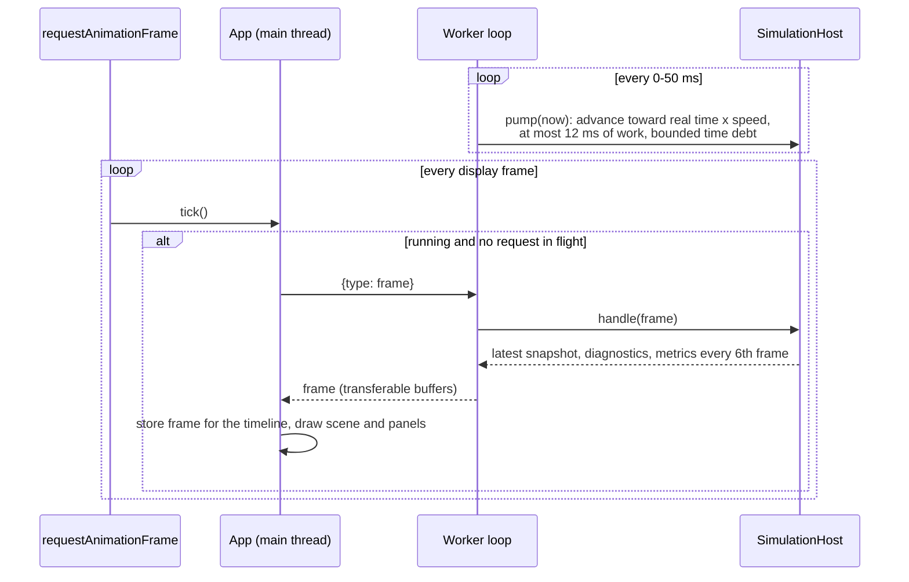
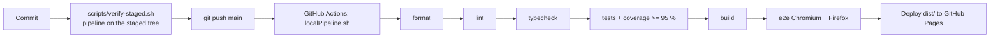

# Architecture

PourLab is a static web application: everything runs in the visitor's browser. The diagrams follow the
[C4 model](https://c4model.com/) (context → containers → components) and add flowcharts for the two
runtime loops that matter: the simulation substep and the render/worker exchange.

## Level 1 — System context

## Level 2 — Containers

## Level 3 — Components

## Offline verification and reference tools (Node, not shipped to the browser)

## Simulation substep

## Render loop and worker exchange

## Delivery pipeline

