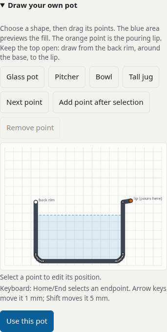

# Run and interpret PourLab

## Start an experiment

1. Open the [public app](https://marcelpetrick.github.io/teapotFluidSimulation/).
2. Keep the default preset for your first run.
3. Press **Pour 400 mL**.
4. Wait for the pot to return upright.
5. Read the actual poured volume and the origin shares.

Blue, green and orange identify the starting layers. A parcel keeps its origin label throughout the run.
The displayed vessel is a 2D cross-section. The spout is enlarged so the grid can resolve it.

The receiving glass shows collected composition. It does not simulate flow inside a cup.

## Compare experiments

Press **Compare with no pour** to keep the current settings with a stationary vessel.
This comparison uses the same duration, fill, seed and numerical settings.

Press **Try a slower pour** to load the slow reference preset.
This loads that preset's settings. Compare the actual discharged volumes before interpreting the mixing scores.

Use **Change the pot** to compare outlet geometry.
Changing geometry also changes the seeded parcels. It cannot preserve an identical initial particle layout.

## Read the results

| Result                   | Meaning                                                     | Limit                                              |
| ------------------------ | ----------------------------------------------------------- | -------------------------------------------------- |
| Origin share             | Fraction of collected liquid from each starting layer.      | It describes this geometry and motion.             |
| Bias B                   | Poured share divided by initial share.                      | B = 1 means proportional sampling.                 |
| Segregation S            | Unevenness of origin composition at a stated spatial scale. | It is not a universal percentage mixed.            |
| Survivor comparison      | The same remaining parcels, initially and now.              | It separates rearrangement from selective removal. |
| Represented-volume drift | Change in the volume represented by occupied grid cells.    | It can exceed 1% despite a closed parcel ledger.   |

Treat the results as exploratory. No measured real-pot experiment has validated this model.
See [validation](validation.md) for the numerical evidence and failed acceptance gates.

## Edit a vessel

1. Open **Draw your own pot**.
2. Choose a template.
3. Select a point by tapping it or pressing **Next point**.
4. Drag the point to change the wall.
5. Use **Add point after selection** to add detail.
6. Press **Use this pot**.

The orange endpoint is the pouring lip. Keep the upper opening clear.
The blue area previews the fill. Applying a shallow pot can lower the fill to prevent overflow.

Keyboard: Home selects the back rim. End selects the lip.
Arrow keys move the selected point by 1 mm. Hold Shift for 5 mm steps.

The editor represents a wall cross-section. It does not create a closed lid or a measured 3D teapot.

## Choose performance settings

Start with **44 cells** and **4 parcels per cell** on a slow device.
Turn off pathlines and shape markers if drawing becomes expensive.
Use the lab look to avoid the extra glow pass.

Increase resolution only for a new run. More parcels increase computation and memory use.
The maximum setting has about 180,000 parcels. A fast redraw does not make that solver run in real time.

At high parcel counts, opaque starting-layer views use a pixel buffer.
All parcels remain in the simulation and metrics. Glow and shape markers retain the ordinary renderer.

Scrubbing updates the scene, collector and initial-position map.
Charts and tables retain the latest experiment measurements; the timeline label states this explicitly.

Read the status line for achieved simulation speed.
If the device falls behind, simulated time slows. The solver keeps stable substeps.

A CPU-throttled desktop test is not a phone certification.
See [performance evidence](performance.md) and the [open hardware question](../questions.md).

## Choose a 3D mode

**Open 3D recording** plays an offline CPU result.
It does not compute a new physical experiment.

**Run 3D live on your GPU** starts the optional WebGPU solver.
It shows its measured speed. WebGPU needs a usable browser adapter and driver.

If a live run fails, start a new live run to request a fresh GPU device, or open the recording.
The 2D baseline does not require WebGPU.

## Save evidence

- **JSON record** saves configuration, versions, diagnostics, limitations and manual inputs.
- **CSV metrics** saves time history and discharge bins.
- **PNG** saves the displayed scene.
- **Copy share link** saves initial settings. It does not encode a later manual tilt history.

Export JSON to retain the manual input history.
Do not infer reproducibility from an image alone.
